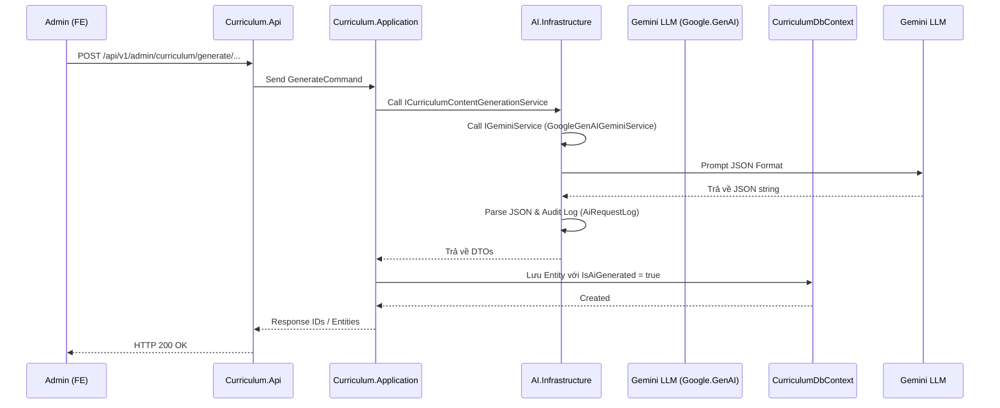

# AI API — Curriculum Content Generation Workflow

> **Mục tiêu:** Mô tả chi tiết kiến trúc, flow hoạt động và cách module `AI` cung cấp khả năng tự động tạo (generate) nội dung cho module `Curriculum`.

---

## 1. Kiến trúc Cross-Module (Curriculum ↔ AI)

Việc tạo dữ liệu (Vocabulary, Grammar, Conversation, Exercise, ExampleSentences) được gọi từ module **Curriculum** nhưng xử lý prompt và kết nối LLM lại nằm ở module **AI**.

### 1.1. Flow Hoạt Động


### 1.2. The Interfaces & Layers
1. **`ICurriculumContentGenerationService` (AI.Contracts):** Cung cấp các method `Generate...Async` với kết quả trả về là DTOs. File này nằm ở `AI.Contracts` nên `Curriculum` có thể reference trực tiếp mà không cần quan tâm đến logic LLM.
2. **`CurriculumContentGenerationService` (AI.Infrastructure):** Implement logic chuyển đổi từ DTOs nội bộ của `IGeminiService` sang DTOs công khai cho `Curriculum`.
3. **`IGeminiService` (AI.Application):** Interface quản lý toàn bộ tính năng giao tiếp LLM của hệ thống (bao gồm Evaluate, Chat, và Generate).
4. **`GoogleGenAIGeminiService` (AI.Infrastructure):** Implement `IGeminiService` thông qua SDK `Google.GenAI`. Quản lý JSON prompt, parse kết quả và lưu lại lịch sử request vào `AiRequestLogs`.

---

## 2. Kỹ thuật Prompting & JSON Validation

Vì output cần phải map chính xác thành các DTOs/Entities, prompt được thiết kế theo cấu trúc sau:

- **System Instruction:** `"You are an AI assistant powering an English learning app. Generate accurate, pedagogically sound, and learner-friendly educational content for English learners. Follow the output format exactly. Output only valid JSON, no markdown."`
- **User Prompt:** Sử dụng template injection để thiết lập bối cảnh (context), số lượng (count), trình độ (level) và ngôn ngữ đích (target languages).
- **Strict JSON Output:** Yêu cầu Gemini trả về JSON tuân thủ đúng schema bằng cách cung cấp raw template (VD: `"items": [{ "title": "<title>", ... }]`).
- **ResponseMimeType:** Cấu hình `ResponseMimeType = "application/json"` cho Google GenAI SDK để ép model trả về JSON hợp lệ.

### Xử lý lỗi (Fault Tolerance)
- Nếu JSON parser fail (`JsonException`), fallback sẽ trả về mảng rỗng `[]` (khi `count > 1`) hoặc 1 item rỗng với lỗi để hạn chế crash app.
- Mọi request (kể cả thành công hay lỗi format JSON) đều được ghi nhận vào `AiRequestLogs` kèm theo `LatencyMs`, `IsSuccess`, và raw `response`.

---

## 3. Các thực thể (Content Types) được hỗ trợ

### 3.1. Vocabulary
- Dựa trên 1 từ gốc (`wordHint`), AI tạo ra nghĩa tiếng Anh, cách phát âm, phiên âm (IPA), từ loại, CEFR level và danh sách các từ đồng nghĩa (synonyms).
- Khi `count > 1`, `wordHint` được dùng như chủ đề (VD: "food"), AI sẽ pick ngẫu nhiên các từ thuộc topic.

### 3.2. Grammar
- AI tạo ra các bài học ngữ pháp gồm tiêu đề, giải thích quy tắc, công thức (formula) và CEFR level.
- AI sẽ tạo kèm theo danh sách các câu ví dụ (`examples`) minh hoạ quy tắc ngữ pháp.

### 3.3. Conversation
- AI tự động lên kịch bản (scenario) hội thoại cho một chủ đề (topic).
- Tạo ra N câu hội thoại qua lại (luân phiên giữa 2 speaker) theo đúng số lượng `lineCount` yêu cầu.

### 3.4. Exercise
- Tùy vào loại bài tập (MultipleChoice, FillInTheBlank, Translation, v.v.), AI tự thiết kế câu hỏi, đưa ra hướng dẫn (`instruction`), đáp án đúng và danh sách các options (nếu là dạng trắc nghiệm).
- Có tính năng giải thích (`explanation`) đáp án.
- **Lưu ý:** AI backend hiện chỉ hỗ trợ các loại exercise text-based. Các bài tập về Media (Listening, Speaking) không được hỗ trợ qua phương thức này.

### 3.5. Example Sentences
- AI có khả năng sinh ra các câu ví dụ rời rạc với lời giải thích (`note`) về cách dùng từ hoặc cấu trúc đó trong câu.

---

## 4. Multi-Language Translations

Một tính năng cốt lõi là AI có khả năng dịch nội dung sang nhiều ngôn ngữ trong cùng một request thông qua tham số `targetLanguageCodes` (ví dụ: `["vi", "ja", "ko"]`).

Prompt được tiêm động:
```json
"translations": {
  "vi": "<translation in vi>",
  "ja": "<translation in ja>"
}
```
Kết quả trả về DTO kiểu dictionary `Dictionary<string, string> Translations`, sau đó Curriculum module sẽ lặp qua dictionary này để lưu vào bảng `...Translations` tương ứng (như `GrammarExampleTranslations`, `ConversationLineTranslations`).
