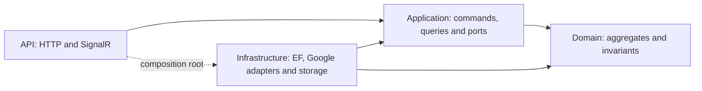

# Target architecture and decisions

Status: proposed implementation target, documented on 2026-10-15. Only documentation was authorized in the initial review. Existing source paths below are the baseline; proposed paths do not exist yet.

## 1. Architectural shape

Retain the four projects and one SQL Server database. This is a single backend with Clean Architecture layer dependencies, tactical DDD on the write side, and CQRS organized by feature/use case.



The runtime still calls Infrastructure implementations through injected interfaces. The diagram describes source dependencies. Folder areas are organizational boundaries, not independently deployed bounded contexts.

## 2. Domain structure

Organize by domain area and then aggregate. An aggregate is a consistency/lifecycle boundary, not every table or every class inheriting a base type. A simple catalog root can remain small; do not invent behavior merely to make it look like DDD.

```text
EnglishLiveTutor.Domain/
  Common/
    Primitives/Entity.cs, AggregateRoot.cs
    Abstractions/IAuditable.cs, ISoftDeletable.cs
  Vocabulary/
    Vocabularies/
      VocabularyEntity.cs
      IVocabularyRepository.cs
      Entities/
        VocabularySenseEntity.cs
        VocabularyPronunciationEntity.cs
        VocabularyWordFamilyEntity.cs
        VocabularyRelationEntity.cs
        VocabularyCollocationEntity.cs
        VocabularyExampleEntity.cs
        VocabularyGrammarPatternEntity.cs
      ValueObjects/                         only when justified
    GenerationRuns/
      VocabularyGenerationAuditEntity.cs
  Learning/
    DailyVocabularyPlans/
      DailyVocabularyPlanEntity.cs
      IDailyVocabularyPlanRepository.cs
      Entities/DailyVocabularyItemEntity.cs
    UserVocabularyProgress/
      UserVocabularyProgressEntity.cs
      IUserVocabularyProgressRepository.cs
    ReviewAttempts/VocabularyReviewAttemptEntity.cs
  Identity/
    Users/
      UserEntity.cs
      IUserRepository.cs
      Entities/UserRoleEntity.cs, RefreshTokenEntity.cs
    Roles/
      RoleEntity.cs
      IRoleRepository.cs
      Entities/RolePermissionEntity.cs
    Permissions/PermissionEntity.cs, IPermissionRepository.cs
  Conversations/
    Conversations/
      ConversationEntity.cs
      IConversationRepository.cs
      Entities/ChatMessageEntity.cs, LanguageCorrectionEntity.cs
  Pronunciation/
    Assessments/
      PronunciationAssessmentEntity.cs
      IPronunciationAssessmentRepository.cs
      Entities/PronunciationCriterionScoreEntity.cs
    ScoringRubrics/
      ScoringRubricEntity.cs
      IScoringRubricRepository.cs
      Entities/ScoringRubricCriterionEntity.cs
    AudioRecordings/AudioRecordingEntity.cs
    GeneratedAudio/GeneratedPronunciationAudioEntity.cs
  Prompts/
    CefrLevelPrompts/CefrLevelPromptEntity.cs
    ConversationModePrompts/ConversationModePromptEntity.cs
    SpeechSpeeds/SpeechSpeedEntity.cs
  AiCatalog/AiModels/AiModelConfigEntity.cs
  Topics/TopicEntity.cs
  Voices/TeacherVoiceEntity.cs
```

This is an illustrative layout. Do not create empty folders. Existing `*Entity` names are retained initially to keep folder moves separate from type renaming. Small areas containing only one aggregate do not need another wrapper folder.

### Aggregate responsibilities

| Aggregate / record | Owns | Rules and lifecycle |
| --- | --- | --- |
| Vocabulary | Senses, pronunciations, word families; each sense owns relations, examples, collocations, grammar patterns | Normalized word/language identity; valid primary-sense policy; content edits preserve referenced sense IDs |
| DailyVocabularyPlan | Daily items | Owner/date/timezone, uniqueness per sense, allowed item completion, plan completion derived from items |
| UserVocabularyProgress | Scheduling/mastery state for one user and sense | Valid rating and SRS transition; atomic counters and next review; distinct legitimate attempts vs request retries |
| VocabularyReviewAttempt | Historical snapshot | Append-only record written with its progress transition; independent lifecycle decision before changing its current base |
| User | Role assignments and refresh tokens, provisionally | Role assignment uniqueness, profile/password transitions, refresh issue/rotation/revoke |
| Role | Permission assignments | Unique grants, system-role protection where it is a business invariant |
| Permission | Permission definition | Valid unique code; referenced by ID |
| Conversation | Messages and corrections, provisionally | Ownership, settings, turn/message identity and ordering; see streaming exception below |
| ScoringRubric | Criteria | Valid ranges, unique criterion codes, enabled weights, version/publication policy |
| PronunciationAssessment | Criterion scores and historical snapshots | Matching reference target, legal score ranges and assessment state; compute scores in one authoritative policy |
| AudioRecording | Audio metadata | Real storage lifecycle if retention is promised; otherwise represent metadata-only semantics explicitly |
| GeneratedPronunciationAudio | Cached audio and key metadata | Normalized target/profile/hash, validity, regeneration/retention; may ultimately be Infrastructure cache data |
| Generation audit | Run result/counts/error metadata | Decide immutable result record vs mutable run lifecycle; current code is not strictly append-only |
| AI model / topic / voice / prompt / speed | Their own catalog data | Small independently managed roots, with explicit normalization and active/deleted semantics |

Root methods own rules that depend on multiple children. Children can have local behavior, but callers must not persist them independently to bypass root invariants. For example, a root method can locate the owned sense and delegate its local update; it need not duplicate that logic.

Cross-aggregate relationships normally use IDs. Resolving whether a sense belongs to a vocabulary or whether a user may use a target is an Application lookup/policy; the root cannot query SQL to prove it.

### Streaming conversation exception

Do not load an entire growing transcript graph for every audio chunk. First establish the actual transaction boundary for a finalized turn:

1. Keep Conversation as root and expose targeted write operations through an Application conversation writer port, with enforced ownership, parent visibility and turn identity; or
2. Promote a message/turn to its own aggregate if its concurrency/lifecycle is independent, with an explicit mapping and consistency decision.

Choose one in the conversation slice after characterizing current ordering/deduplication. Do not quietly retain direct child writes while documenting that every write goes through the full Conversation graph. Raw audio streaming itself is not a command per audio chunk.

### Primitive values and base classes

- Introduce `CefrLevel`, `ReviewRating`, target/profile values, or learning date values where they remove observed divergent rules. Keep serialized/storage representations stable through explicit mappings.
- Application obtains `now` from `TimeProvider` and resolves timezone/calendar policy; Domain receives values needed for deterministic transitions.
- `AggregateRoot` need not imply soft-deletable. Separate deletion capability incrementally where audit/cache/history lifecycles need it, after mapping/schema impact is known.
- Domain events are optional. Add them for a demonstrated decoupling/consistency need, not because DDD appears in the architecture name.

## 3. Application and CQRS

```text
EnglishLiveTutor.Application/
  Common/
    Cqrs/                                  existing lightweight contracts
    Persistence/                           shared read abstraction, IUnitOfWork
    Identity/ICurrentUser.cs
    Models/PagedResultDto.cs                result shape, not EF query execution
  Features/
    Learning/
      Commands/
        InitializeDailyVocabularyPlan/
          InitializeDailyVocabularyPlanCommand.cs
          InitializeDailyVocabularyPlanHandler.cs
        SubmitVocabularyReview/
          SubmitVocabularyReviewCommand.cs
          SubmitVocabularyReviewHandler.cs
      Queries/
        GetDailyVocabularyPlan/
        GetLearningProgress/
        GetLearningHistory/
      Contracts/
      Policies/                            feature orchestration, if needed
    Vocabulary/
      Commands/CreateVocabulary/, UpdateVocabulary/, GenerateVocabulary/, ImportVocabularyJson/
      Queries/GetVocabularyFlashcard/, ListVocabularyFlashcards/, BuildVocabularyGenerationPrompt/
      Contracts/
      Ports/IVocabularyAiGenerator.cs, IVocabularyGenerationContent.cs
      Mapping/
    Conversations/
      Commands/
      Queries/
      LiveSessions/                        control/orchestration, not websocket JSON
      Contracts/
      Ports/ILiveSessionService.cs, ILiveSessionRealtimeNotifier.cs
    Pronunciation/
      Commands/
      Queries/
      Contracts/
      Ports/
      Policies/
    Identity/, Prompts/, Topics/, Voices/, AiModels/
```

A small use case may keep request and handler in one file; the requirement is one coherent use case folder. Split the current multi-use-case `AdminIdentityCrudCommands.cs`. Keep shared feature DTOs in feature `Contracts`; keep a DTO used only by one query with that query if clearer.

Write flow: bind command -> validate input/ownership -> load necessary aggregates -> invoke domain transitions -> stage history -> commit once -> map named result. Repository contracts remain next to domain aggregates; `IUnitOfWork` belongs to Application and is implemented by Infrastructure. Repositories used in one command share one scoped `AppDbContext` and do not commit individually in the final design.

Read flow: query -> read scope -> filter by user/root visibility -> SQL projection/paging -> named DTO. EF Core LINQ in Application is allowed through an Application-owned read interface/factory exposing query surfaces and disposal, without `SaveChanges`/mutable `DbSet` methods. Provider-specific SQL/optimized read implementations can use feature read ports implemented in Infrastructure. Do not add a read repository for every table.

One local transaction across plan, progress and attempt is acceptable. Do not make every HTTP operation a generic transaction decorator if it would hold a transaction over Google HTTP/WebSocket work. Resolve reference snapshots first, call provider, then enter the short write operation and handle changed versions explicitly.

## 4. Infrastructure

```text
EnglishLiveTutor.Infrastructure/
  Persistence/
    AppDbContext.cs
    Configurations/<Feature>/
    Repositories/<Feature>/
    Interceptors/
    Seeding/                               coordinator + focused seeders/data
  Migrations/                              preserve existing identities/history
  Ai/
    Google/                                HTTP, websocket setup, response parsing
  Realtime/
    Transport/                             bridge, reconnect and resource ownership
    Sessions/                              in-memory session state adapter
  Identity/
  Storage/                                 only if actual recording retention is chosen
  DependencyInjection.cs
```

Moves do not require database changes. Register aggregate write repositories/context/UoW as scoped. A singleton realtime adapter opens a fresh operation scope for each persisted callback/use case; it must not capture scoped repositories. Read factories can be singleton if they only create independent scopes/contexts safely.

Migrations and seeding are separate operational concerns even if development runs both at startup. Define startup readiness/failure policy; do not suppress model mismatch warnings to make a structural refactor pass. Seeding must preserve administrator-managed data and be idempotent for both an empty and a partially initialized database.

Soft-delete filters on roots do not automatically filter direct child queries. Read paths must join/filter the root. Interceptor handling must only preserve descendants of the specific soft-deleted root, with a deliberate rule for simultaneous unrelated child deletions.

## 5. API

Keep Minimal API and the existing three SignalR hubs. Group HTTP endpoints by feature; move AI model CRUD out of `PronunciationEndpoints` when that slice is implemented. Use named Application responses and explicit transport mappings when replacing currently serialized entities.

Hubs depend on Application session ports. The provider adapter owns websocket protocol; Application controls access, workflow and persistence calls. Keep hub URL, method names, event names, argument order and payload shapes during structural work.

For personal data, authentication and resource ownership are separate checks. Explicitly support anonymous demo behavior only if chosen as a product feature with a separate identity/isolation policy. Never infer authorization from a caller-supplied conversation ID or `X-User-Id`.

Central error mapping may replace repeated endpoint catches, but preserve the current `{ error }` contract initially. A switch to ProblemDetails, stricter GUID parsing, default paging, or altered status codes is a separately tracked compatibility change.

## 6. Decisions still requiring product/runtime evidence

See the decision table and phase gates in [the refactor plan](../docs/backend-refactor-plan.md). Review alone does not settle anonymous demo support, historic conversation ownership, review retry semantics, rubric publication, audio retention or cross-instance session requirements.
